# UX-01 Gate 0: founder design-review package

- **Status:** PROPOSAL for founder review.
  - **Every image here is a static mock-up** built from the tokens in [../DESIGN.md](../DESIGN.md). **None is a screenshot of the implemented application.** Each mock-up carries a visible "Entwurf" label, and all data is synthetic.
  - **Layout:** Direction B, the work queue, which the founder selected on 2026-10-20 as the preferred direction. The selection is provisional and subject to the owner usability test ([../owner-usability-test.md](../owner-usability-test.md)).
- **Decisions under review:**
  - [DG-10](../../decisions/DG-10-owner-app-visual-language.md) (stays PROVISIONAL)
  - [ADR-0025](../../adr/0025-frontend-architecture.md)
  - [DESIGN.md](../DESIGN.md)
  - [visual-regression-plan.md](../visual-regression-plan.md)
  - [design-references.md](../design-references.md)

## How the images were made

- **Source:**
  - the HTML pages in [mockups/](mockups/) and the shared [mockups/proposal.css](mockups/proposal.css), which mirrors DESIGN.md §3;
  - one synthetic data set: the four canonical callback titles and the `+49 30 0000…` fixture numbers of [visual-regression-plan.md](../visual-regression-plan.md) §3.

  Nothing here is imported by `apps/web` or `packages/ui`.

- **Rendering:** `node docs/design/review/render-mockups.mjs`, from the repository root.
  - It uses Playwright 1.63.0 Chromium (the repository's pinned test browser) on local files, with device scale 1, `de-DE`, `Europe/Berlin` and reduced motion.
  - Viewports are 1440×900, 768×1024 and 390×844, captured full page.
  - Two consecutive runs produce byte-identical images.
- **Fonts:** [fonts.conf](fonts.conf) resolves `system-ui` to Roboto at render time, which is what Android owners see; the CSS font stack is DESIGN.md's, unchanged. On Windows and Apple devices the same stack resolves to Segoe UI or San Francisco, so letterforms and line breaks differ slightly. (The first Gate 0 images used the Linux DejaVu fallback, which is about 14% wider than any owner's system font.)
- **Checks in the same run.** Any failure exits non-zero.
  - **Per page and width:**
    - no horizontal scroll;
    - WCAG text contrast of every visible text element;
    - every link and button at least 44 × 44 px and 8 px from the next;
    - axe with the WCAG 2.0–2.2 A/AA tags.
  - **On the Heute pages, the preserved contracts:**
    - the h1 "Heute";
    - region names;
    - "Offen" in every task;
    - `Erledigt: <title>` on every button, or the unavailable line instead;
    - call links named by the raw number;
    - `<time>`;
    - the empty line in every empty region.
- **What these images are not:** executable acceptance evidence. That comes only from the gates in [visual-regression-plan.md](../visual-regression-plan.md) and DESIGN.md §9, run against the real application.

## Image inventory

| Image                                                                                                  | Shows                                                                                                                                 |
| ------------------------------------------------------------------------------------------------------ | ------------------------------------------------------------------------------------------------------------------------------------- |
| [foundations-1440](images/foundations-1440.png)                                                        | tokens and contrast, type, spacing, the "Erledigt" action states, other buttons, the call link, status chips                          |
| [heute-populated-1440](images/heute-populated-1440.png)                                                | desktop: four synthetic callbacks, one urgent                                                                                         |
| [heute-populated-768](images/heute-populated-768.png)                                                  | tablet: two-line rows                                                                                                                 |
| [heute-populated-390](images/heute-populated-390.png)                                                  | phone: full-width task blocks                                                                                                         |
| [heute-empty-1440](images/heute-empty-1440.png), [heute-empty-390](images/heute-empty-390.png)         | nothing open: all sections in one quiet panel                                                                                         |
| [heute-busy-1440](images/heute-busy-1440.png)                                                          | a busy queue: ten tasks, two urgent, some from the evening before                                                                     |
| [heute-actions-1440](images/heute-actions-1440.png), [heute-actions-390](images/heute-actions-390.png) | one task and its action states: urgent, standard, hover, keyboard focus, pressed, "Wird gespeichert …", unavailable, after "Erledigt" |
| [heute-states-1440](images/heute-states-1440.png), [heute-states-390](images/heute-states-390.png)     | page states: signed out, loading, read failed, refresh delayed (proposed, DESIGN.md §6.1), truncated list                             |

The dashed "Zustand" and "Anmerkung" labels explain the mock-up only and are not part of the design.

## A. Foundations

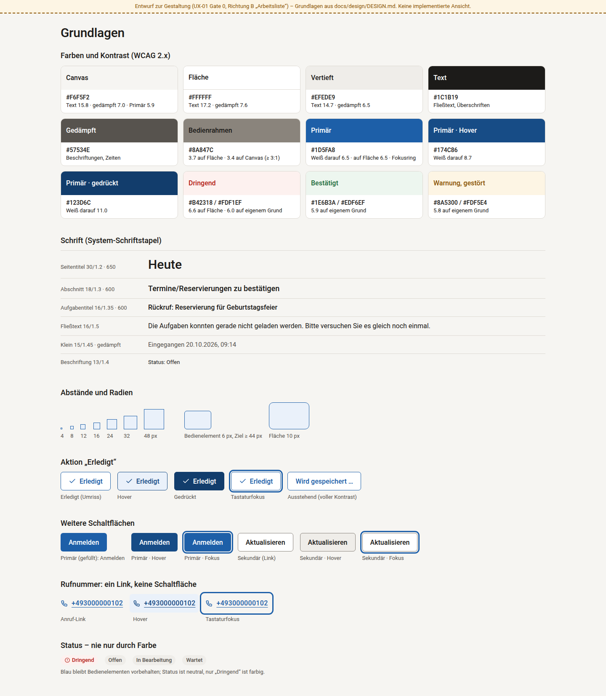

- **Contrast:** every text pair is 4.5:1 or more, and control boundaries and focus rings are 3:1 or more (DESIGN.md §3.1).
- **Blue means "you can act here":** "Erledigt", call links, the active navigation entry and the focus ring. Statuses are neutral chips; only "Dringend" has a colour, always with its word and icon.
- **"Erledigt" is outlined:** blue text and border 6.5:1; hover 7.7:1; pressed is a filled `#123D6C` with white text (11.0:1). This is provisional, pending the owner test's criterion C5.
- **Type:** the system stack. Task titles are 16/600, section titles 18/600 and the page title 26–30/650, with tabular figures for times and numbers.
- **Correction after the first independent review:** the "Bedienrahmen" swatch label is `#1C1B19` on `#8A847C` (4.65:1); it was white (3.70:1).

## B. Heute with callbacks

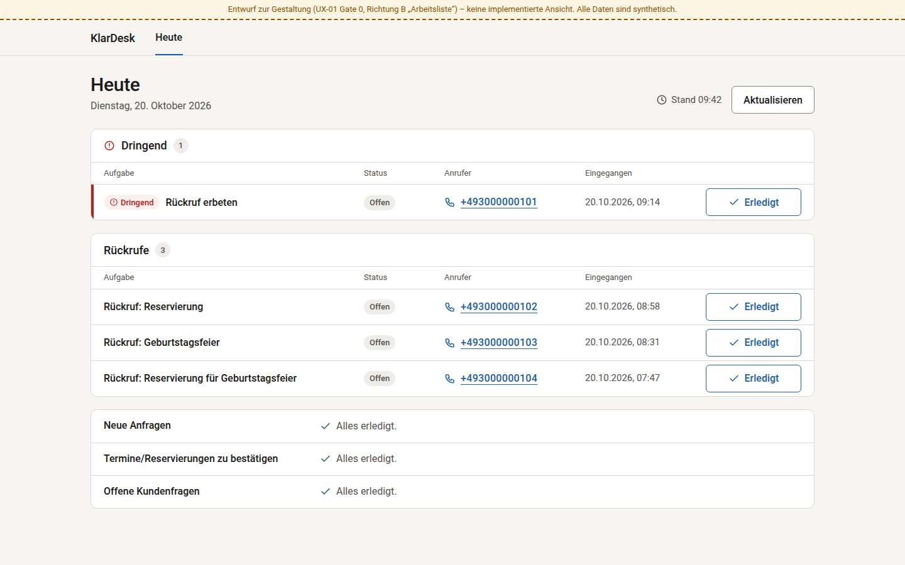

- **Panels:** one per section with tasks, and one row per task in fixed columns: Aufgabe · Status · Anrufer · Eingegangen · action.
- **Reading order:** the list reads top to bottom in the API's order (urgent first, then newest); there is no multi-column grid of tasks.
- **Column labels** are visual only. Each cell carries its own `<dt>` for assistive technology.
- **Urgent:** a red bar plus the "Dringend" chip on the row, and an icon before the panel heading.
- **Counts** are shown because the list isn't truncated.
- **Empty sections** share one quiet panel and keep their order, their heading and "Alles erledigt.".

| Tablet 768 px                                              | Phone 390 px                                              |
| ---------------------------------------------------------- | --------------------------------------------------------- |
| 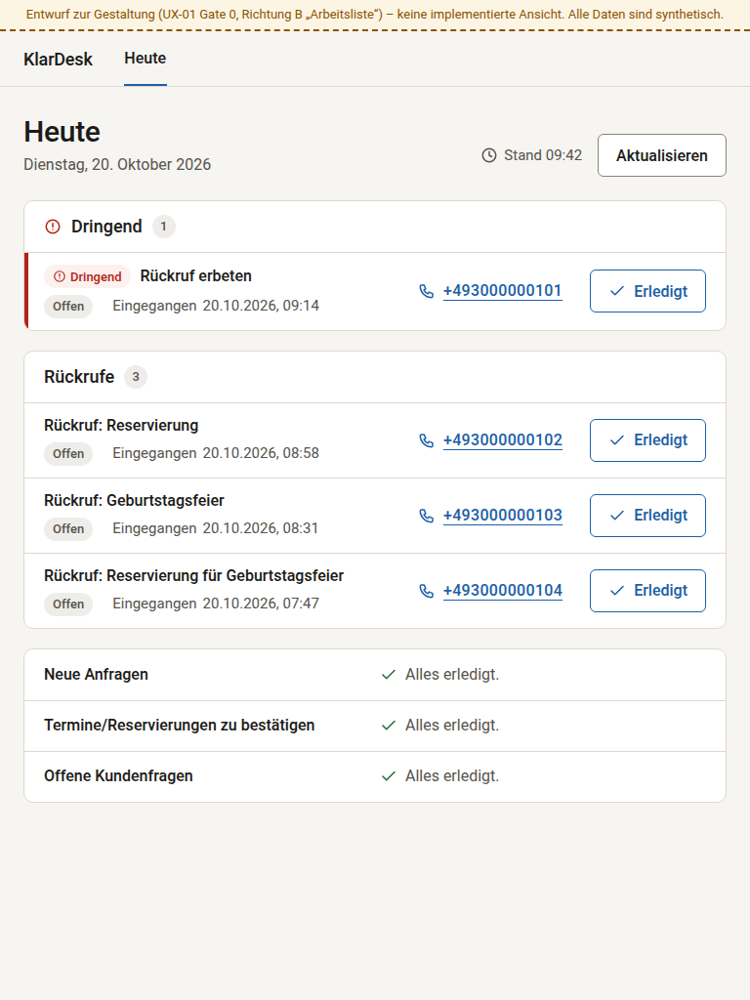 | 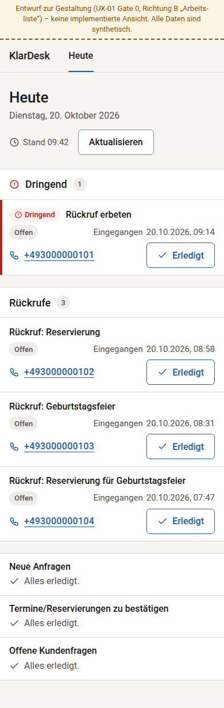 |

- **768–1099 px:** two lines per task. The facts sit under the title, and the call link and action at the right.
- **Below 768 px:** one full-width block per task: title; status and receipt time; then the call link (left) and "Erledigt" (right). Panels run edge to edge.

## C. Nothing open

| Desktop 1440 px                                      | Phone 390 px                                      |
| ---------------------------------------------------- | ------------------------------------------------- |
| 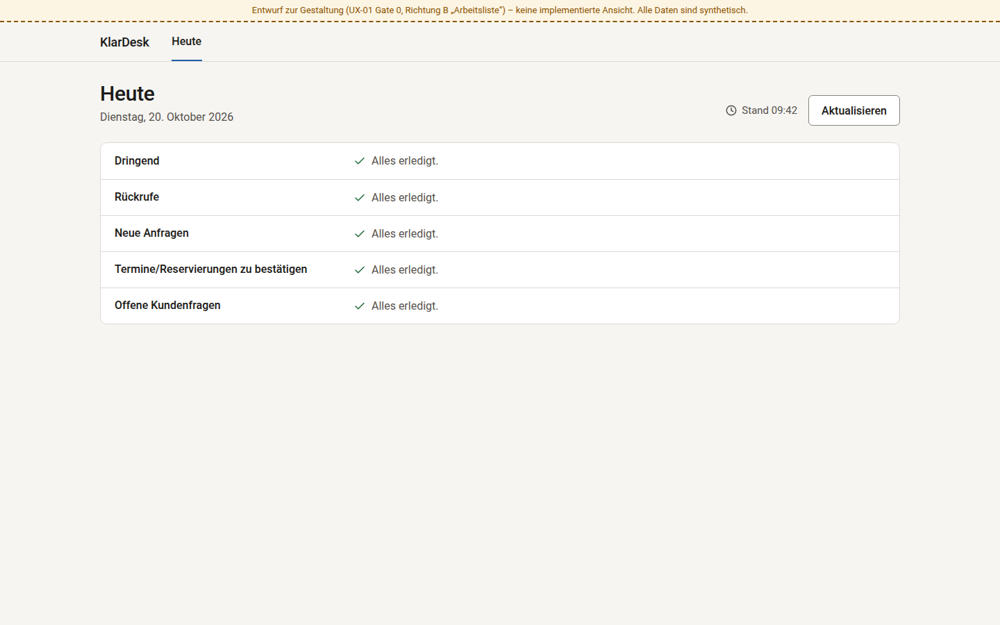 | 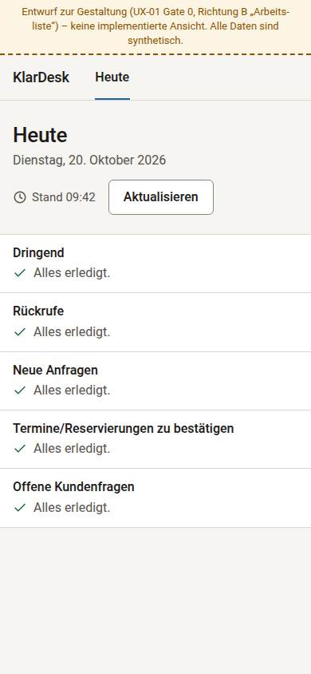 |

All five sections stay in PLAN order, each its own region with "Alles erledigt.". No counts are drawn.

## D. A busy queue

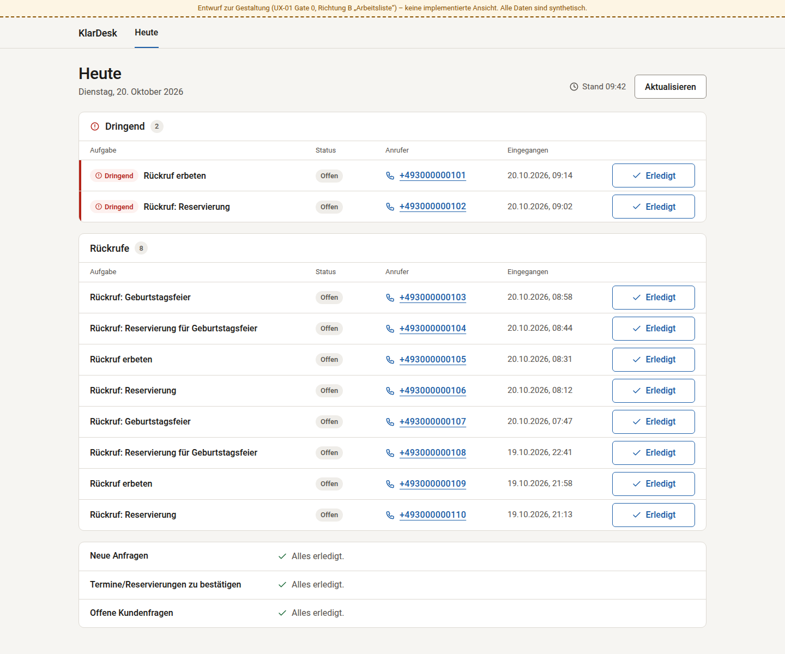

- **Data:** ten synthetic tasks, the size of P13's morning-review criterion. They repeat the four canonical titles and include tasks from the evening before.
- **Growth:** a row is 57 px, so a longer list grows downwards in one column without changing its layout.
- **Truncation:** above `TODAY_TASK_LIMIT` the API truncates and the page drops its counts (E).
- **What doesn't exist:** no pagination, filter or sort control, because the app has none.

## E. The task and its action states; page states

| Action states, desktop                                   | Action states, phone                                  |
| -------------------------------------------------------- | ----------------------------------------------------- |
| 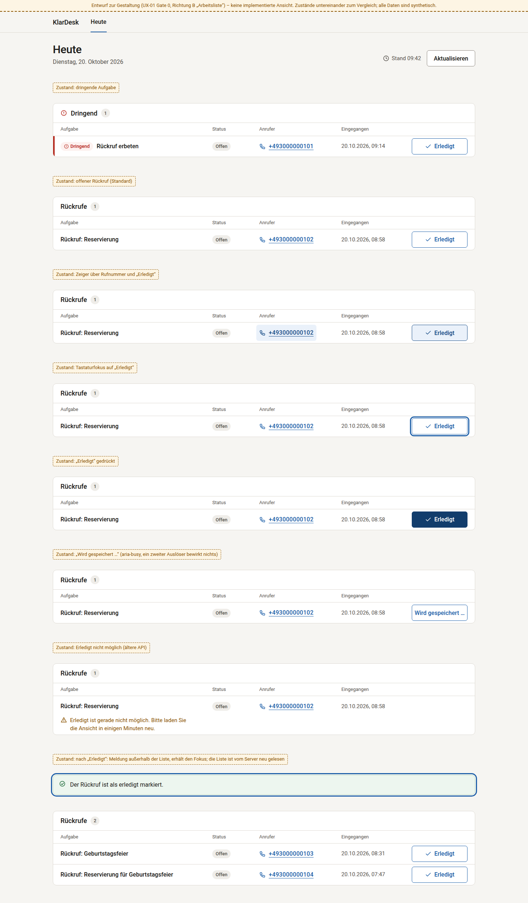 | 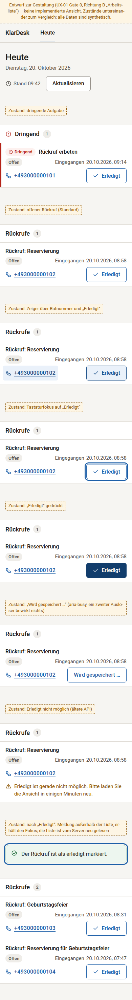 |

| Page states, desktop                                  | Page states, phone                                 |
| ----------------------------------------------------- | -------------------------------------------------- |
| 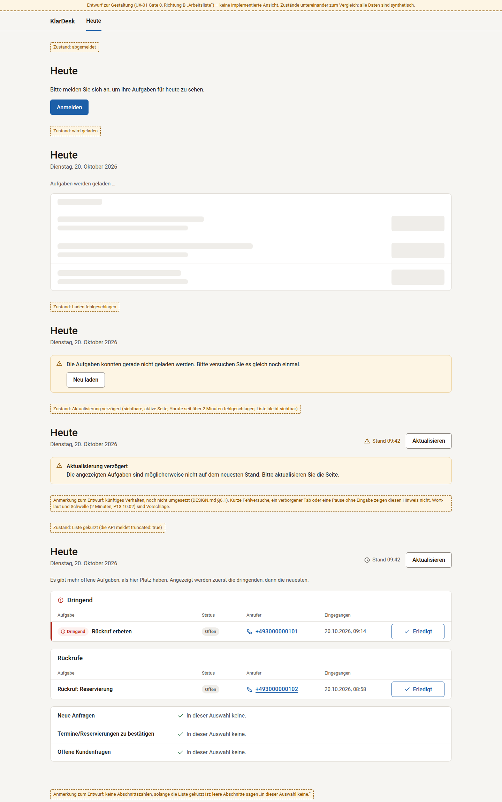 | 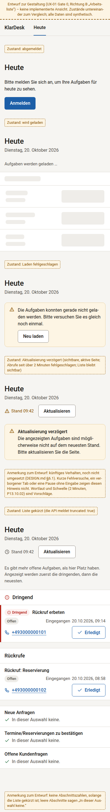 |

- **Pending:** "Wird gespeichert …" keeps full contrast. Its accessible-name issue is an implementation obligation (DESIGN.md §9).
- **After "Erledigt":** the outcome notice sits outside the list and receives focus. The row leaves only after the server re-read (no optimistic UI).
- **Refresh delayed:** proposed future behaviour, not implemented (DESIGN.md §6.1, gate RH).

## F. What changes compared with today's unstyled Heute

**No before screenshot from the application is part of this package.** The executable before set is captured from the main commit in UX-01 gate 2a ([visual-regression-plan.md](../visual-regression-plan.md) §6); until then there is no comparison to report.

From the current source (`apps/web/app/layout.tsx`, `apps/web/app/page.tsx`), today's page:

- **Font:** sets no font family, so the browser default (typically a serif) renders everything.
- **Width:** a 360 px column below 768 px, then 768 px, then 1280 px, so lines run very long on desktop.
- **Elements:** browser-default bullets, underlined blue links and a two-column `<dl>`.
- **Cards and buttons:** a 1 px grey border per card and a black-outlined white "Erledigt" button.
- **Status:** a plain "Status: Offen" row; urgent work isn't distinguished beyond its section.

**What the proposal changes:**

1. **Order you can read:** one top-to-bottom queue per section, with the call link and the action in fixed places.
2. **Finding work:** urgent rows have a bar and a word; empty sections shrink to one quiet panel.
3. **Clear action:** one "Erledigt" per task; the number is a call link, not a second button.
4. **Trust:** counts only when they are the whole truth; honest degraded states; no invented numbers.
5. **Accessibility:** tested contrast, 44 px targets, a visible 3 px focus ring, and status never by colour alone.

**What it doesn't change:** the data flow, the API, authentication, CSRF, live updates, the completion behaviour, the phone-number and time formats, and every test selector (DESIGN.md §5).
